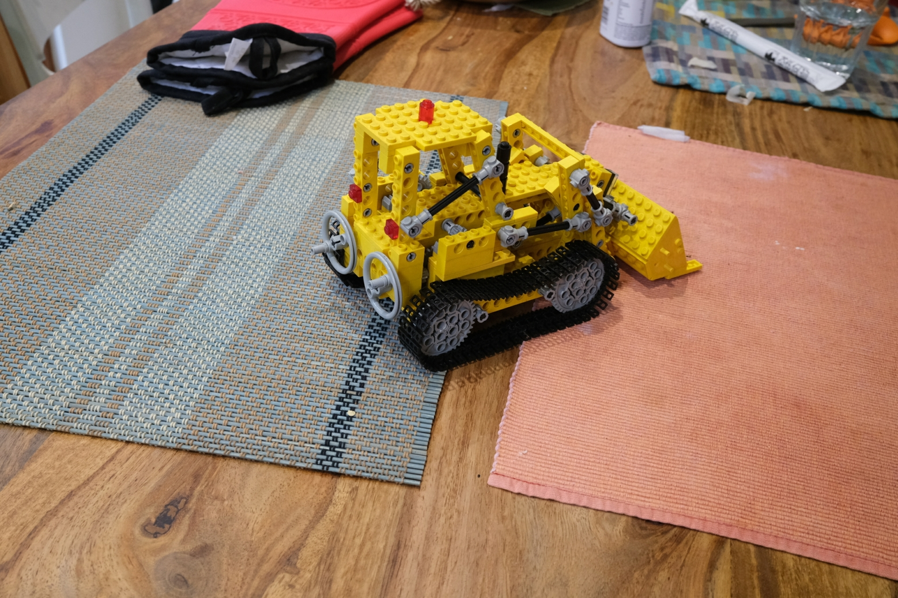
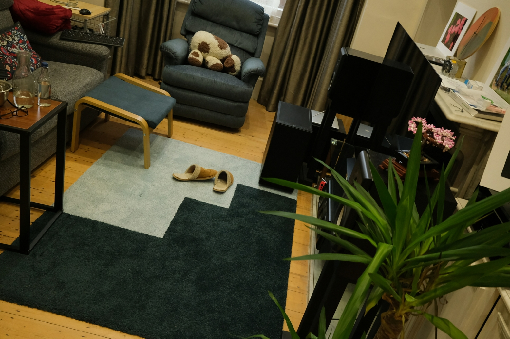
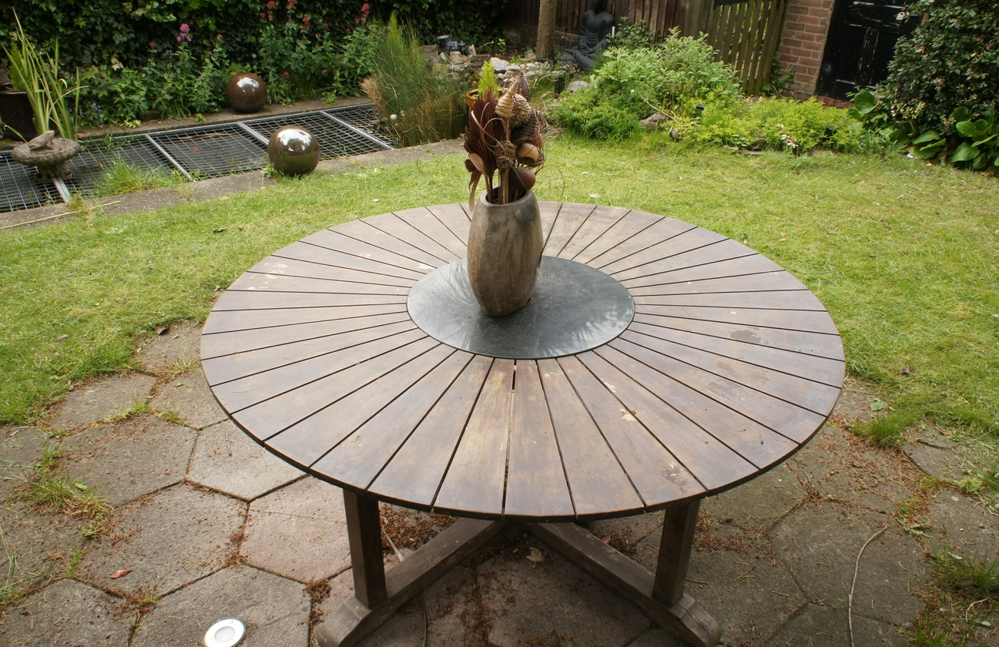
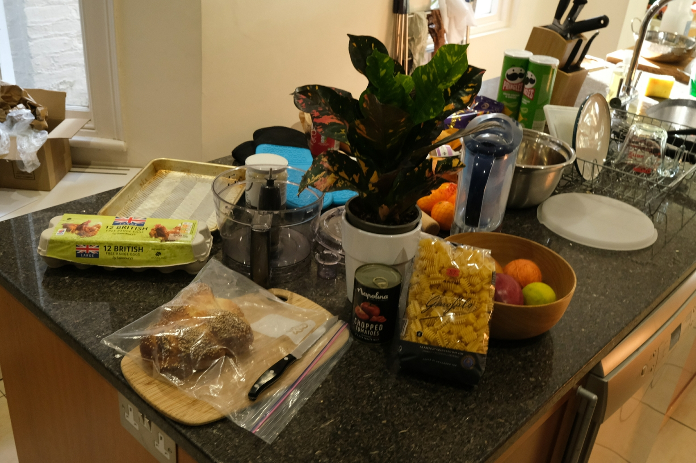

# PRF v2 · 细核组物理分辨率

评估一次层级加细中，方向尺度变小的高斯所对应的观测支持、核尺度、中心间距及综合物理分辨率。

[1. 新物理分辨率定义](#1-新物理分辨率定义) · [2. 四项指标的计算公式](#2-四项指标的计算公式) · [3. 安装](#3-安装) · [4. 调用](#4-调用) · [5. 测试结果展示](#5-测试结果展示)

## 1. 新物理分辨率定义

PRF v2 以一次层级加细中的**细核组**为统计对象：只有已展开、且方向尺度小于对应父节点 0.99 倍的子节点参与计算。它描述这批高斯的尺度，不替代 v1 的全场景 patch 统计。

$$
R_{\mathrm{phy},q}^{\mathrm{detail}}
=\max\!\left(
R_{\mathrm{obs},q}^{\mathrm{detail}},
R_{\mathrm{kernel},q}^{\mathrm{detail}},
R_{\mathrm{spacing},q}^{\mathrm{detail}}
\right),\qquad q\in\{0.5,0.9\}.
$$

| 指标 | 含义 | 对应限制 |
| --- | --- | --- |
| 观测项 $R_{\mathrm{obs}}^{\mathrm{detail}}$ | 训练图像在细核所在表面的采样支持 | 相机采样 |
| 核项 $R_{\mathrm{kernel}}^{\mathrm{detail}}$ | 细核的方向尺度 | 高斯核尺度 |
| 间距项 $R_{\mathrm{spacing}}^{\mathrm{detail}}$ | 细核中心到同表面邻居的平均距离 | 中心分布密度 |
| 物理项 $R_{\mathrm{phy}}^{\mathrm{detail}}$ | 前三项分别汇总后取最大值 | 三者中尺度最大的限制 |

数值越小表示对应尺度越细。P50 与 P90 分别报告；**先对局部做场景汇总，再按分位数取三项最大值**。三项使用同一批有效局部和同一套权重。训练相机不会因层级加细而增加，因此观测项不代表新增观测。

## 2. 四项指标的计算公式

### 2.1 统计对象与加权分位数

方向 $\theta$ 用 ROI 的两条切向合成，不再单位化：

$$
t=\cos\theta\, t_1+\sin\theta\, t_2.
$$

单个高斯的方向尺度是切向标准差乘 3.77。$\Sigma_i$ 是该高斯的世界坐标协方差。

$$
\sigma_i=3.77\sqrt{t^{\mathsf T}\Sigma_i t},\qquad
\rho_i=\frac{\sigma_i^{\mathrm{child}}}{\sigma_i^{\mathrm{parent}}}.
$$

展开且 $\rho_i<0.99$ 的子节点进入细核组。$\rho_i\in[0.99,1.01]$ 为相近，$\rho_i>1.01$ 为变粗，未展开为保留。后三类不进入下面的分位数。

组内分位数是可见权重的离散逆 CDF。把细核节点按数值从小到大排列，权重为 $w_i$，

$$
F(k)=\frac{\sum_{i=1}^{k} w_{(i)}}{\sum_i w_i}.
$$

$Q_q$ 取第一个满足 $F(k)\ge q$ 的数值。

### 2.2 观测项

$R_{\mathrm{obs}}^{\mathrm{detail}}$ 是细核组所在表面位置上的训练图像采样支持。训练相机不随层级增加，所以它不是新增观测分辨率。

在固定切平面的点 $x$ 上，相机 $c$ 的投影雅可比为 $J_c(x)$，最弱方向的世界尺度是 $r_c(x)=1/\sigma_{\min}(J_c(x))$。在视锥内可见、且夹角至少 $12^\circ$ 的真实训练相机对中，

$$
r_{\mathrm{obs}}(x)=\min_{(a,b)}\max(r_a(x),r_b(x)).
$$

细核中心先投影到冻结平面，再用 `observation_resolutions` 查询。它按上面的雅可比和相机对直接算出每个位置的 $r_{\mathrm{obs}}(x)$；`detail_observation_quantiles` 继续用可见权重取 P50/P90。没有有效相机对就留空。只做视锥筛选时，结果必须标明遮挡尚未验证。

局部观测指标同样采用细核中心的可见权重分位数：

$$
R_{\mathrm{obs},j,q}^{\mathrm{detail}}
=Q_{q}^{\mathrm{visible}}\!\left(r_{\mathrm{obs}}(x_i)\right),
\qquad q\in\{0.5,0.9\}.
$$

### 2.3 核项

局部组合 $j$ 的核指标是

$$
R_{\mathrm{kernel},j,50}^{\mathrm{detail}}=Q_{0.5}^{\mathrm{visible}}(\sigma_i),\qquad
R_{\mathrm{kernel},j,90}^{\mathrm{detail}}=Q_{0.9}^{\mathrm{visible}}(\sigma_i).
$$

### 2.4 间距项

间距在同一张切平面上计算。对细核中心 $u_i$，在当前层全部同表面中心中取 6 个其他中心；与查询点或已选邻居距离不超过 $\varepsilon$ 的中心不占名额。$\varepsilon$ 按实验约定取 ROI 短边的 $10^{-4}$，调用时需显式传入 `eps`。

$$
s_i=\frac{1}{6}\sum_{r=1}^{6}\lVert u_i-u_{n_r}\rVert.
$$

不足 6 个时 $s_i$ 留空，不减小 $k$。第六近邻距离达到切向缓冲边界时，该中心不进入分位数。局部间距是

$$
R_{\mathrm{spacing},j,50}^{\mathrm{detail}}=Q_{0.5}^{\mathrm{visible}}(s_i),\qquad
R_{\mathrm{spacing},j,90}^{\mathrm{detail}}=Q_{0.9}^{\mathrm{visible}}(s_i).
$$

### 2.5 场景汇总与物理项

场景汇总先做颜色软权重。$\Delta E_j$ 未测量时该项不进入求和，也不记为 0。$N$ 是该场景的计划局部数；多数场景为 45，具体分母见测试结果。

$$
g_j=\mathrm{clip}\!\left(\frac{\Delta E_j}{0.02},0,1\right),\qquad
w_j=\frac{1}{N}\big[(1-\lambda)+\lambda g_j\big].
$$

把有效局部值按从小到大排序。加权中位数是累积权重第一次达到总权重一半时的那个数值：

$$
R_{\cdot,q}^{\mathrm{detail}}
=\min\lbrace v:\sum_{R_{\cdot,j,q}^{\mathrm{detail}}\le v} w_j
\ge \frac{1}{2}\sum_j w_j\rbrace.
$$

物理项在汇总之后、按分位数分别取较大值：

$$
R_{\mathrm{phy},50}^{\mathrm{detail}}
=\max\big(R_{\mathrm{obs},50}^{\mathrm{detail}},R_{\mathrm{kernel},50}^{\mathrm{detail}},R_{\mathrm{spacing},50}^{\mathrm{detail}}\big),
$$

$$
R_{\mathrm{phy},90}^{\mathrm{detail}}
=\max\big(R_{\mathrm{obs},90}^{\mathrm{detail}},R_{\mathrm{kernel},90}^{\mathrm{detail}},R_{\mathrm{spacing},90}^{\mathrm{detail}}\big).
$$

可见权重、$\Delta E$ 和某一局部是否有效由调用方传入。本库不渲染。

## 3. 安装

```bash
# Python >= 3.10
git clone --branch prf-v2 https://github.com/hjc0106/ALod-Prf.git
cd ALod-Prf
python -m pip install -e .
```

## 4. 调用

以下为接入已有场景数据的调用流程；输入由调用方提供，变量约定见代码后的表格。

```python
from prf_detail import (
    covariance_world, directional_scale, directional_tangent,
    detail_kernel_quantiles, detail_spacing_quantiles, neighbor_spacing,
    refinement_group, detail_observation_quantiles, summarize_detail,
)

tangent = directional_tangent(tangent_1, tangent_2, direction_deg=0.0)
child = directional_scale(covariance_world(rotations, scales), tangent)
parent = directional_scale(parent_covariances, tangent)
kernel = detail_kernel_quantiles(child, parent, expanded, visible_weights)

# 三个局部指标都以同一批细核为统计对象。
finer = refinement_group(child, parent, expanded) == 0
spacing, accepted = neighbor_spacing(
    pool_xy, query_xy[finer], own_index[finer], k=6, eps=eps, margin=margin[finer],
)
local_spacing = detail_spacing_quantiles(spacing, accepted, visible_weights[finer])
obs = detail_observation_quantiles(
    plane_points[finer], tangent_1, tangent_2, training_views, visible_weights[finer],
)

# 遍历各 ROI × 方向后，把 kernel / local_spacing / obs 的 p50、p90
# 分别收集成下面六个等长列表；eligible 使用三项均有效的共同局部集合。
summary = summarize_detail(
    obs_p50, obs_p90, kernel_p50, kernel_p90, spacing_p50, spacing_p90,
    delta_e, eligible, lam=0.5, planned=45,
)
print(summary["obs_p50"], summary["kernel_p50"], summary["spacing_p50"], summary["phy_p50"])
```

| 输入 | 约定 |
| --- | --- |
| `rotations` / `scales` | `(M, 4)` 的 wxyz 四元数 / `(M, 3)` 的线性尺度，尺度需先从 log 域还原。 |
| `parent_covariances` / `expanded` | 与 M 个子节点逐一对应的父协方差 `(M, 3, 3)` / 是否展开 `(M,)`。 |
| `tangent_1` / `tangent_2` | 冻结 ROI 的两条三维切向，与计算公式采用相同尺度。 |
| `pool_xy` / `query_xy` / `own_index` | 当前层全部同表面中心 `(K, 2)` / M 个子中心的切平面坐标 `(M, 2)` / 子中心在池中的索引 `(M,)`。 |
| `plane_points` / `visible_weights` | 投影到冻结平面的子中心 `(M, 3)` / 可见权重 `(M,)`。 |
| `eps` / `margin` | 去重阈值 / 每个子中心到切向缓冲边界的距离 `(M,)`，均用切平面坐标单位。 |
| `training_views` | 真实训练相机列表；每个相机提供 `w2c`、`center`、`fx`、`fy`、`cx`、`cy`、`width`、`height`。 |
| 六个分位数列表 / `delta_e` / `eligible` | 按同一局部顺序对齐；缺测值用 `None`，共同有效标记由调用方确定。`planned` 为实际计划局部数。 |

观测查询默认 `delta=0.05`、`min_camera_z=1.0`、`min_pair_angle_deg=12.0`，可通过 `detail_observation_quantiles(..., **kwargs)` 调整。返回的 `visible_views` 和 `valid_pairs` 可用于诊断。

## 5. 测试结果展示

### 5.1 场景训练图片

以下展示六个测试场景的真实训练图片，选自各场景 `training_transforms.json` 的训练帧列表。每个场景取列表中间的一帧，保留原始图片内容；图下标注场景与帧名。图片用于展示测试场景的外观。

<table>
<tbody>
<tr>
<td align="center" width="33%"><br><strong>Kitchen</strong><br><sub>DSCF0796.JPG</sub></td>
<td align="center" width="33%"><br><strong>Room</strong><br><sub>DSCF4823.JPG</sub></td>
<td align="center" width="33%"><br><strong>Garden</strong><br><sub>DSC08048.JPG</sub></td>
</tr>
<tr>
<td align="center" width="33%"><br><strong>Counter</strong><br><sub>DSCF5978.JPG</sub></td>
<td align="center" width="33%"><br><strong>Bonsai</strong><br><sub>DSCF5711.JPG</sub></td>
<td align="center" width="33%"><br><strong>Bicycle</strong><br><sub>_DSC8777.JPG</sub></td>
</tr>
</tbody>
</table>

图片来自 Mip-NeRF 360 场景数据中的 `images_2`（室内）或 `images_4`（室外）目录。帧名、训练清单和文件校验值见 [图片来源记录](results/training-images/sources.json)。

### 5.2 全部场景数值

11 个场景、55 个层级对。主结果取 $\lambda=0.5$。每一行的核、间距、观测和物理项使用同一批有效局部、同一套 $\Delta E$ 和同一套权重。表内是 P50 / P90，四舍五入到 5 位有效数字。完整数值见 [CSV 数据](results/all_scenes_detail_lambda0.5.csv)。

“—”表示不可估。有效数的分母是该场景原来的计划局部数：Kitchen、Room、Garden、Counter、Bonsai、Bicycle、Stump、Train 为 45，Truck 为 108，DrJohnson 为 54，Playroom 为 18。Train 使用机车标定后的米，其余场景用各自的坐标单位，不能跨场景比较绝对大小。观测只做视锥筛选，遮挡未验证。

<details>
<summary>展开 11 个场景、55 个层级对的完整结果（P50 / P90）</summary>

<table>
<thead><tr>
<th align="left">场景</th>
<th align="left">层级对</th>
<th align="right">核</th>
<th align="right">间距</th>
<th align="right">观测</th>
<th align="right">物理项</th>
<th align="right">有效</th>
<th align="left">单位</th>
</tr></thead>
<tbody>
<tr><td align="left">Kitchen</td><td align="left">L0→L1</td><td align="right">0.065656 / 0.17142</td><td align="right">0.036913 / 0.046086</td><td align="right">0.0030439 / 0.0030716</td><td align="right">0.065656 / 0.17142</td><td align="right">6/45</td><td align="left">场景单位</td></tr>
<tr><td align="left">Kitchen</td><td align="left">L1→L2</td><td align="right">0.046981 / 0.062747</td><td align="right">0.026571 / 0.035672</td><td align="right">0.0030425 / 0.0030856</td><td align="right">0.046981 / 0.062747</td><td align="right">6/45</td><td align="left">场景单位</td></tr>
<tr><td align="left">Kitchen</td><td align="left">L2→L3</td><td align="right">0.036931 / 0.092741</td><td align="right">0.018778 / 0.033548</td><td align="right">0.0030398 / 0.0030796</td><td align="right">0.036931 / 0.092741</td><td align="right">6/45</td><td align="left">场景单位</td></tr>
<tr><td align="left">Kitchen</td><td align="left">L3→L4</td><td align="right">0.02812 / 0.062592</td><td align="right">0.01291 / 0.023574</td><td align="right">0.003039 / 0.0030971</td><td align="right">0.02812 / 0.062592</td><td align="right">6/45</td><td align="left">场景单位</td></tr>
<tr><td align="left">Kitchen</td><td align="left">L4→L5</td><td align="right">0.023381 / 0.044807</td><td align="right">0.010311 / 0.017792</td><td align="right">0.0030368 / 0.0030975</td><td align="right">0.023381 / 0.044807</td><td align="right">7/45</td><td align="left">场景单位</td></tr>
<tr><td align="left">Room</td><td align="left">L0→L1</td><td align="right">0.37713 / 0.45366</td><td align="right">0.22598 / 0.30125</td><td align="right">0.0067841 / 0.0083484</td><td align="right">0.37713 / 0.45366</td><td align="right">1/45</td><td align="left">场景单位</td></tr>
<tr><td align="left">Room</td><td align="left">L1→L2</td><td align="right">0.13201 / 1.1324</td><td align="right">0.1021 / 0.367</td><td align="right">0.0089671 / 0.0094071</td><td align="right">0.13201 / 1.1324</td><td align="right">3/45</td><td align="left">场景单位</td></tr>
<tr><td align="left">Room</td><td align="left">L2→L3</td><td align="right">0.098214 / 0.13502</td><td align="right">0.054288 / 0.1147</td><td align="right">0.0092362 / 0.0094897</td><td align="right">0.098214 / 0.13502</td><td align="right">3/45</td><td align="left">场景单位</td></tr>
<tr><td align="left">Room</td><td align="left">L3→L4</td><td align="right">0.079642 / 0.14066</td><td align="right">0.04479 / 0.094496</td><td align="right">0.0090249 / 0.0093735</td><td align="right">0.079642 / 0.14066</td><td align="right">3/45</td><td align="left">场景单位</td></tr>
<tr><td align="left">Room</td><td align="left">L4→L5</td><td align="right">0.076376 / 0.095605</td><td align="right">0.036887 / 0.078459</td><td align="right">0.0089768 / 0.0094282</td><td align="right">0.076376 / 0.095605</td><td align="right">3/45</td><td align="left">场景单位</td></tr>
<tr><td align="left">Garden</td><td align="left">L0→L1</td><td align="right">0.19631 / 0.37186</td><td align="right">0.22575 / 0.37167</td><td align="right">0.015131 / 0.016621</td><td align="right">0.22575 / 0.37186</td><td align="right">1/45</td><td align="left">场景单位</td></tr>
<tr><td align="left">Garden</td><td align="left">L1→L2</td><td align="right">0.28689 / 0.75924</td><td align="right">0.21483 / 0.52823</td><td align="right">0.013736 / 0.016269</td><td align="right">0.28689 / 0.75924</td><td align="right">2/45</td><td align="left">场景单位</td></tr>
<tr><td align="left">Garden</td><td align="left">L2→L3</td><td align="right">0.14904 / 0.70756</td><td align="right">0.10984 / 0.41474</td><td align="right">0.014262 / 0.01667</td><td align="right">0.14904 / 0.70756</td><td align="right">3/45</td><td align="left">场景单位</td></tr>
<tr><td align="left">Garden</td><td align="left">L3→L4</td><td align="right">0.070337 / 0.15527</td><td align="right">0.061779 / 0.16151</td><td align="right">0.013757 / 0.016183</td><td align="right">0.070337 / 0.16151</td><td align="right">6/45</td><td align="left">场景单位</td></tr>
<tr><td align="left">Garden</td><td align="left">L4→L5</td><td align="right">0.039858 / 0.17116</td><td align="right">0.020741 / 0.070408</td><td align="right">0.0059464 / 0.0064164</td><td align="right">0.039858 / 0.17116</td><td align="right">4/45</td><td align="left">场景单位</td></tr>
<tr><td align="left">Counter</td><td align="left">L0→L1</td><td align="right">0.052353 / 0.13687</td><td align="right">0.029548 / 0.050094</td><td align="right">0.0022815 / 0.00239</td><td align="right">0.052353 / 0.13687</td><td align="right">6/45</td><td align="left">场景单位</td></tr>
<tr><td align="left">Counter</td><td align="left">L1→L2</td><td align="right">0.045201 / 0.098187</td><td align="right">0.02172 / 0.035549</td><td align="right">0.0022713 / 0.0023809</td><td align="right">0.045201 / 0.098187</td><td align="right">6/45</td><td align="left">场景单位</td></tr>
<tr><td align="left">Counter</td><td align="left">L2→L3</td><td align="right">0.036421 / 0.069288</td><td align="right">0.016959 / 0.032649</td><td align="right">0.0021719 / 0.0021814</td><td align="right">0.036421 / 0.069288</td><td align="right">8/45</td><td align="left">场景单位</td></tr>
<tr><td align="left">Counter</td><td align="left">L3→L4</td><td align="right">0.022254 / 0.066246</td><td align="right">0.0095882 / 0.017444</td><td align="right">0.0021701 / 0.0021788</td><td align="right">0.022254 / 0.066246</td><td align="right">12/45</td><td align="left">场景单位</td></tr>
<tr><td align="left">Counter</td><td align="left">L4→L5</td><td align="right">0.019728 / 0.046825</td><td align="right">0.0096624 / 0.018144</td><td align="right">0.0021686 / 0.0021803</td><td align="right">0.019728 / 0.046825</td><td align="right">9/45</td><td align="left">场景单位</td></tr>
<tr><td align="left">Bonsai</td><td align="left">L0→L1</td><td align="right">—</td><td align="right">—</td><td align="right">—</td><td align="right">—</td><td align="right">0/45</td><td align="left">场景单位</td></tr>
<tr><td align="left">Bonsai</td><td align="left">L1→L2</td><td align="right">—</td><td align="right">—</td><td align="right">—</td><td align="right">—</td><td align="right">0/45</td><td align="left">场景单位</td></tr>
<tr><td align="left">Bonsai</td><td align="left">L2→L3</td><td align="right">—</td><td align="right">—</td><td align="right">—</td><td align="right">—</td><td align="right">0/45</td><td align="left">场景单位</td></tr>
<tr><td align="left">Bonsai</td><td align="left">L3→L4</td><td align="right">0.017233 / 0.17751</td><td align="right">0.0074788 / 0.030649</td><td align="right">0.0020697 / 0.0021183</td><td align="right">0.017233 / 0.17751</td><td align="right">1/45</td><td align="left">场景单位</td></tr>
<tr><td align="left">Bonsai</td><td align="left">L4→L5</td><td align="right">0.017019 / 0.080115</td><td align="right">0.0075303 / 0.012051</td><td align="right">0.0020593 / 0.00212</td><td align="right">0.017019 / 0.080115</td><td align="right">2/45</td><td align="left">场景单位</td></tr>
<tr><td align="left">Bicycle</td><td align="left">L0→L1</td><td align="right">0.076627 / 0.17855</td><td align="right">0.023169 / 0.043079</td><td align="right">0.0026132 / 0.0028144</td><td align="right">0.076627 / 0.17855</td><td align="right">8/45</td><td align="left">场景单位</td></tr>
<tr><td align="left">Bicycle</td><td align="left">L1→L2</td><td align="right">0.058055 / 0.097038</td><td align="right">0.01512 / 0.036507</td><td align="right">0.0026065 / 0.0028137</td><td align="right">0.058055 / 0.097038</td><td align="right">8/45</td><td align="left">场景单位</td></tr>
<tr><td align="left">Bicycle</td><td align="left">L2→L3</td><td align="right">0.047344 / 0.082962</td><td align="right">0.010385 / 0.024529</td><td align="right">0.002611 / 0.0028157</td><td align="right">0.047344 / 0.082962</td><td align="right">8/45</td><td align="left">场景单位</td></tr>
<tr><td align="left">Bicycle</td><td align="left">L3→L4</td><td align="right">0.030316 / 0.072788</td><td align="right">0.0081766 / 0.0196</td><td align="right">0.0026077 / 0.0028051</td><td align="right">0.030316 / 0.072788</td><td align="right">6/45</td><td align="left">场景单位</td></tr>
<tr><td align="left">Bicycle</td><td align="left">L4→L5</td><td align="right">0.026694 / 0.066315</td><td align="right">0.0064018 / 0.015796</td><td align="right">0.002611 / 0.0028114</td><td align="right">0.026694 / 0.066315</td><td align="right">5/45</td><td align="left">场景单位</td></tr>
<tr><td align="left">Stump</td><td align="left">L0→L1</td><td align="right">0.071872 / 0.15971</td><td align="right">0.035494 / 0.060656</td><td align="right">0.003303 / 0.0033941</td><td align="right">0.071872 / 0.15971</td><td align="right">11/45</td><td align="left">场景单位</td></tr>
<tr><td align="left">Stump</td><td align="left">L1→L2</td><td align="right">0.056183 / 0.15564</td><td align="right">0.026247 / 0.044407</td><td align="right">0.0032781 / 0.0034064</td><td align="right">0.056183 / 0.15564</td><td align="right">11/45</td><td align="left">场景单位</td></tr>
<tr><td align="left">Stump</td><td align="left">L2→L3</td><td align="right">0.044131 / 0.12181</td><td align="right">0.020289 / 0.035345</td><td align="right">0.0032826 / 0.0034051</td><td align="right">0.044131 / 0.12181</td><td align="right">11/45</td><td align="left">场景单位</td></tr>
<tr><td align="left">Stump</td><td align="left">L3→L4</td><td align="right">0.024535 / 0.078993</td><td align="right">0.01034 / 0.019012</td><td align="right">0.0032722 / 0.0034014</td><td align="right">0.024535 / 0.078993</td><td align="right">11/45</td><td align="left">场景单位</td></tr>
<tr><td align="left">Stump</td><td align="left">L4→L5</td><td align="right">0.020523 / 0.049841</td><td align="right">0.010803 / 0.017775</td><td align="right">0.0032804 / 0.0033743</td><td align="right">0.020523 / 0.049841</td><td align="right">12/45</td><td align="left">场景单位</td></tr>
<tr><td align="left">Truck</td><td align="left">L0→L1</td><td align="right">0.095058 / 0.2227</td><td align="right">0.028497 / 0.049003</td><td align="right">0.0043228 / 0.0045787</td><td align="right">0.095058 / 0.2227</td><td align="right">6/108</td><td align="left">场景单位</td></tr>
<tr><td align="left">Truck</td><td align="left">L1→L2</td><td align="right">0.068207 / 0.1663</td><td align="right">0.020321 / 0.037081</td><td align="right">0.0043712 / 0.0045962</td><td align="right">0.068207 / 0.1663</td><td align="right">6/108</td><td align="left">场景单位</td></tr>
<tr><td align="left">Truck</td><td align="left">L2→L3</td><td align="right">0.052419 / 0.15221</td><td align="right">0.016324 / 0.029234</td><td align="right">0.0042631 / 0.0045715</td><td align="right">0.052419 / 0.15221</td><td align="right">6/108</td><td align="left">场景单位</td></tr>
<tr><td align="left">Truck</td><td align="left">L3→L4</td><td align="right">0.037321 / 0.1192</td><td align="right">0.0098084 / 0.020844</td><td align="right">0.0043269 / 0.0046006</td><td align="right">0.037321 / 0.1192</td><td align="right">5/108</td><td align="left">场景单位</td></tr>
<tr><td align="left">Truck</td><td align="left">L4→L5</td><td align="right">0.033026 / 0.10256</td><td align="right">0.0096199 / 0.02056</td><td align="right">0.0041197 / 0.004553</td><td align="right">0.033026 / 0.10256</td><td align="right">5/108</td><td align="left">场景单位</td></tr>
<tr><td align="left">Train</td><td align="left">L0→L1</td><td align="right">0.39992 / 0.80775</td><td align="right">0.17488 / 0.42012</td><td align="right">0.0046957 / 0.0052031</td><td align="right">0.39992 / 0.80775</td><td align="right">10/45</td><td align="left">米</td></tr>
<tr><td align="left">Train</td><td align="left">L1→L2</td><td align="right">0.3372 / 0.74718</td><td align="right">0.14217 / 0.38179</td><td align="right">0.0045597 / 0.0051989</td><td align="right">0.3372 / 0.74718</td><td align="right">15/45</td><td align="left">米</td></tr>
<tr><td align="left">Train</td><td align="left">L2→L3</td><td align="right">0.3266 / 0.65112</td><td align="right">0.1056 / 0.24645</td><td align="right">0.0045478 / 0.0047025</td><td align="right">0.3266 / 0.65112</td><td align="right">10/45</td><td align="left">米</td></tr>
<tr><td align="left">Train</td><td align="left">L3→L4</td><td align="right">0.16537 / 0.49757</td><td align="right">0.071209 / 0.12003</td><td align="right">0.0045696 / 0.0047087</td><td align="right">0.16537 / 0.49757</td><td align="right">13/45</td><td align="left">米</td></tr>
<tr><td align="left">Train</td><td align="left">L4→L5</td><td align="right">0.17798 / 0.40274</td><td align="right">0.062048 / 0.14302</td><td align="right">0.00457 / 0.0047028</td><td align="right">0.17798 / 0.40274</td><td align="right">8/45</td><td align="left">米</td></tr>
<tr><td align="left">DrJohnson</td><td align="left">L0→L1</td><td align="right">0.10851 / 0.28599</td><td align="right">0.053421 / 0.068329</td><td align="right">0.0034535 / 0.0034966</td><td align="right">0.10851 / 0.28599</td><td align="right">5/54</td><td align="left">场景单位</td></tr>
<tr><td align="left">DrJohnson</td><td align="left">L1→L2</td><td align="right">0.087998 / 0.26022</td><td align="right">0.031143 / 0.077077</td><td align="right">0.0034562 / 0.0035067</td><td align="right">0.087998 / 0.26022</td><td align="right">5/54</td><td align="left">场景单位</td></tr>
<tr><td align="left">DrJohnson</td><td align="left">L2→L3</td><td align="right">0.068044 / 0.21679</td><td align="right">0.019913 / 0.038288</td><td align="right">0.0034644 / 0.003507</td><td align="right">0.068044 / 0.21679</td><td align="right">5/54</td><td align="left">场景单位</td></tr>
<tr><td align="left">DrJohnson</td><td align="left">L3→L4</td><td align="right">0.062172 / 0.18661</td><td align="right">0.019062 / 0.038712</td><td align="right">0.0034535 / 0.0035017</td><td align="right">0.062172 / 0.18661</td><td align="right">5/54</td><td align="left">场景单位</td></tr>
<tr><td align="left">DrJohnson</td><td align="left">L4→L5</td><td align="right">0.032527 / 0.099664</td><td align="right">0.014439 / 0.034952</td><td align="right">0.0034738 / 0.0035055</td><td align="right">0.032527 / 0.099664</td><td align="right">5/54</td><td align="left">场景单位</td></tr>
<tr><td align="left">Playroom</td><td align="left">L0→L1</td><td align="right">0.12557 / 0.27901</td><td align="right">0.044588 / 0.11372</td><td align="right">0.00476 / 0.0059707</td><td align="right">0.12557 / 0.27901</td><td align="right">6/18</td><td align="left">场景单位</td></tr>
<tr><td align="left">Playroom</td><td align="left">L1→L2</td><td align="right">0.13318 / 0.23295</td><td align="right">0.049067 / 0.096556</td><td align="right">0.0047938 / 0.0049709</td><td align="right">0.13318 / 0.23295</td><td align="right">10/18</td><td align="left">场景单位</td></tr>
<tr><td align="left">Playroom</td><td align="left">L2→L3</td><td align="right">0.078129 / 0.19375</td><td align="right">0.03368 / 0.061826</td><td align="right">0.0047823 / 0.0049798</td><td align="right">0.078129 / 0.19375</td><td align="right">10/18</td><td align="left">场景单位</td></tr>
<tr><td align="left">Playroom</td><td align="left">L3→L4</td><td align="right">0.054682 / 0.15076</td><td align="right">0.019455 / 0.048851</td><td align="right">0.0047936 / 0.0049874</td><td align="right">0.054682 / 0.15076</td><td align="right">11/18</td><td align="left">场景单位</td></tr>
<tr><td align="left">Playroom</td><td align="left">L4→L5</td><td align="right">0.064147 / 0.15527</td><td align="right">0.019471 / 0.060146</td><td align="right">0.0047831 / 0.0049798</td><td align="right">0.064147 / 0.15527</td><td align="right">9/18</td><td align="left">场景单位</td></tr>
</tbody>
</table>

</details>

52 个层级对可估。Bonsai 的前三个层级对没有共同有效项。

可估结果里，Garden 的 L0→L1 由间距决定 P50，L3→L4 由间距决定 P90。其余可估结果的物理项 P50 和 P90 都由核决定。观测在这些位置上都更小。

有效集合覆盖有限，而且可以随层级对变化，不能据此说整个场景单调变细。间距 P50 在 Counter、Bonsai、Stump 的最后一步有回升，Playroom 在 L1→L2 和最后一步也有回升。
